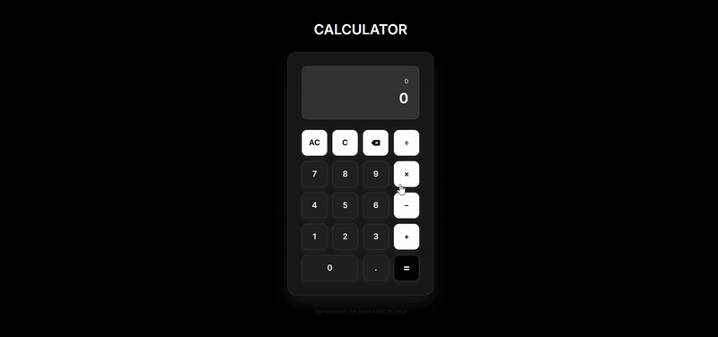

# 🌸🖩 Aesthetic Calculator Web App

Welcome to my **Aesthetic Calculator Web Application**!  
This project combines **Python (Flask)** with **Bootstrap** and **JavaScript** to create a simple yet visually pleasing calculator with smooth animations and full keyboard support.

---

Here’s a quick look at the calculator in action:

 

---

## About This Project

The goal of this project was to make a **basic calculator** feel modern and engaging.  
From the **Aesthetic background** to the **interactive buttons**, every detail was designed to make the user experience smooth and aesthetically satisfying.  

This app is also a practical example of combining **Flask backend** with responsive **front-end design**.

---

## Key Features

- ✅ Modern gradient background with a clean UI  
- ✅ Fully responsive layout (desktop, tablet, mobile)  
- ✅ Interactive buttons with hover and click animations  
- ✅ Full keyboard support for faster calculations  
- ✅ Error handling for invalid operations  
- ✅ Lightweight and fast performance  

---

## Skills Gained

- Python Flask web development  
- Responsive design using Bootstrap  
- JavaScript event handling for UI interactivity  
- Keyboard event integration for web apps  
- CSS animations and gradient styling  
- Error handling in user-facing applications  

---

## 🛠️ Technologies & Tools Used

* **Python (Flask)** — Backend server
* **Bootstrap** — Responsive design framework
* **JavaScript** — Calculator logic & keyboard support
* **HTML5 & CSS3** — Structure and aesthetic styling

---

